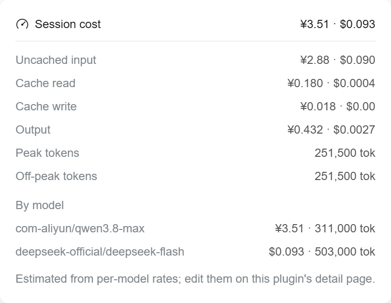
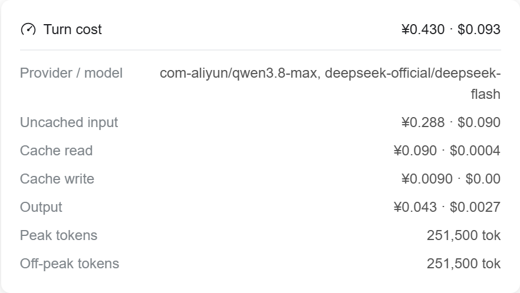
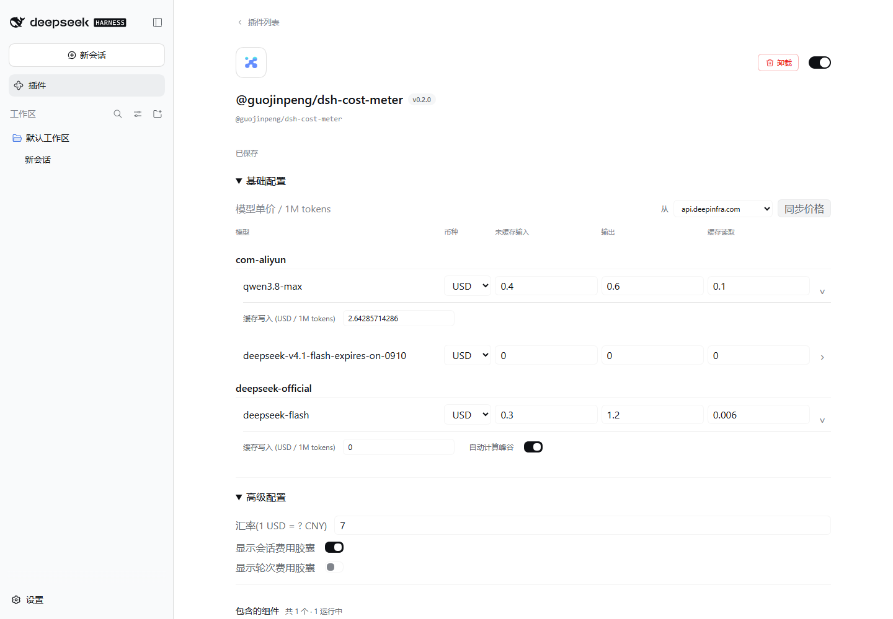

# @guojinpeng/dsh-cost-meter

[English](README.md) | [简体中文](README.zh-CN.md)

This plugin shows estimated session and turn costs in DSH.
Use DSH 0.2.0-rc.2 or later.
Tests use DSH 0.2.0-rc.2.

## Install

1. Install the npm package:

```powershell
dsh plugin --profile web add -w @guojinpeng/dsh-cost-meter
```

2. Restart DSH.
3. Open **Plugins**.
4. Select **@guojinpeng/dsh-cost-meter** to change prices.

Replace `web` with your profile name.
If you used the old unscoped package, disable it before you install this package.

Install published versions from npm. npm provides the built package.
GitHub contains the source code and release notes.

## Features

- Shows session and completed-turn cost estimates.
- Shows a short initialization message when model prices are not ready.
- Shows input, output, cache-read and cache-write cost details.
- Groups used models by provider. The list comes from DSH session history.
- Supports separate prices for each full `provider/model` name.
- Selects models.dev, openrouter.ai or api.deepinfra.com as the price source.
- Initializes new model prices from the selected source's local cache. Uses zero if there is no matching price.
- Downloads model prices only when you select **Sync prices**.
- Syncs only configured models. Asks for confirmation before prices are overwritten.
- Matches source prices by model ID. models.dev prefers manufacturer prices; OpenRouter and DeepInfra supply their own platform prices. Keeps existing prices if matching is unclear.
- Keeps existing prices when the source cannot supply a supported rate.
- Supports USD or CNY for each model. Converts all four rates when you change its currency.
- Shows separate USD and CNY totals when a session or turn uses both currencies.
- Saves valid changes automatically, in order. Keeps unfinished input and shows save errors.
- Shows basic settings first. Advanced settings contain the exchange rate and session/turn visibility controls.
- Puts cache-write prices and DeepSeek peak/off-peak controls in each model's advanced settings.
- Applies half the peak rate outside Beijing weekday hours 09:00–12:00 and 14:00–18:00, and on weekends and Chinese public holidays.
- Uses holiday-cn annual calendars, cached under `data/holidays/`. Fetches a missing year in the background.
- Stores configuration at `~/.dsh/guojinpeng/dsh-cost-meter/config.json`. Uses `DSH_HOME` when set.
- Copies the old `~/.dsh/dsh-cost-meter/config.json` on first start if the new file does not exist. Keeps the old file.
- Uses isolated plugin, client, API, projection, style and configuration identifiers.

These screenshots use example model prices. They do not show a billing statement.

Existing model prices without a currency remain USD. Existing DeepSeek entries without a peak/off-peak setting keep fixed rates until you sync them or enable the setting. Confirmed original-vendor DeepSeek off-peak rates from models.dev are multiplied by two to store peak rates. The setting is enabled by default for new DeepSeek provider entries, not for DeepSeek models from other providers.

The configuration file stays at the same path. No configuration migration is required. Historical usage is replayed to restore dates and time windows. Requests that cross a price boundary are estimated from the recorded usage settlement time. If a holiday calendar is unavailable, uncertain weekday windows use the peak rate until the calendar is loaded.

`priceSource` selects the cache for new models. Existing configuration without this field uses models.dev. Each model's `source` records its last price import; edits to rates on the configuration page set it to `manual`. Changing the selected source does not change existing rates or fetch prices. Cost calculation uses only the saved rates.

Caches are separate: `data/models.dev.json`, `data/openrouter.ai.json` and `data/api.deepinfra.com.json`. OpenRouter and DeepInfra prices are not multiplied by two. Entries with automatic DeepSeek off-peak pricing keep their rates when the source cannot confirm an official peak rate. Sync reports show skipped models and cache-write rates that were kept because the cache duration is unclear. Conditional prices and non-token charges are outside this fixed-rate estimate.

Session cost details:



Turn cost details:



Model price settings:



## Develop From Source

Install Node.js, pnpm 9 and Git. Install DSH globally before you run the tests:

```powershell
npm install -g @deepseek-ai/dsh@0.2.0-rc.2
git clone https://github.com/guojinpeng/dsh-cost-meter.git
cd dsh-cost-meter
pnpm install --frozen-lockfile
```

Edit files in `src/`. Run tests and create a package:

```powershell
npm test
npm run build
npm pack
```

`npm pack` also runs the build. It creates `guojinpeng-dsh-cost-meter-<version>.tgz`.
Install the generated file in your DSH profile. For version 0.2.0:

```powershell
dsh plugin --profile web add -w ./guojinpeng-dsh-cost-meter-0.2.0.tgz
```

Restart DSH and check the plugin. Repeat the build, package and install steps after changes.
Tests use the global DSH installation. Set `DSH_RUNTIME_ROOT` to the DSH package directory if its location is different.
Commit source files and `pnpm-lock.yaml`. Do not commit generated files or local configuration.
See [the module guide](docs/architecture.md) for source boundaries and verification commands.

## Publish To npm

Use an npm account with publish access to `@guojinpeng/dsh-cost-meter`.
Run these commands in the project directory:

```powershell
npm login --registry=https://registry.npmjs.org/
npm whoami --registry=https://registry.npmjs.org/
npm view @guojinpeng/dsh-cost-meter version --registry=https://registry.npmjs.org/
```

An unpublished package can return `E404` from `npm view`.
For an update, choose a version that is newer than the published version.
Update `package.json`. You can use this command to increase the patch version without creating a Git tag:

```powershell
npm version patch --no-git-tag-version
pnpm install --lockfile-only
npm test
npm run pack:release
```

Check the package file list. `pack:release` runs `npm pack` and creates the versioned
npm tarball. Commit and push the version change. Then publish that tarball.
For example, replace `<version>` with the new version number:

```powershell
npm publish ./guojinpeng-dsh-cost-meter-<version>.tgz --access public --registry=https://registry.npmjs.org/
npm view @guojinpeng/dsh-cost-meter version --registry=https://registry.npmjs.org/
```

Complete npm's authentication steps when prompted.
Each package version can be published only once.
After npm publication succeeds, create the matching Git tag and GitHub Release:

```powershell
git tag v<version>
git push origin v<version>
gh release create v<version> --verify-tag --title "<version>" --generate-notes --latest
```

Replace `<version>` before you run these commands. GitHub Releases contain release
notes; uploading a tarball is optional. npm hosts the installation package.
The plugin catalog links the npm package through its `repository` field.

Users can then install the package:

```powershell
dsh plugin --profile web add -w @guojinpeng/dsh-cost-meter
```
