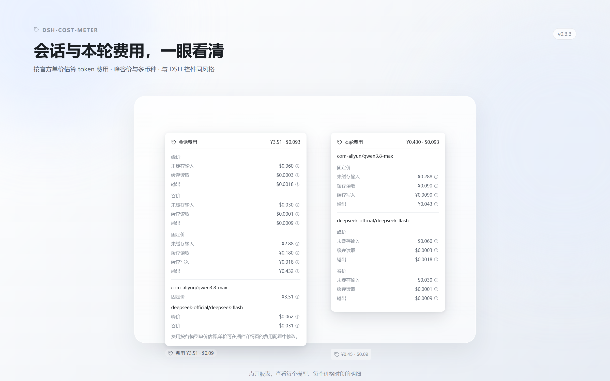
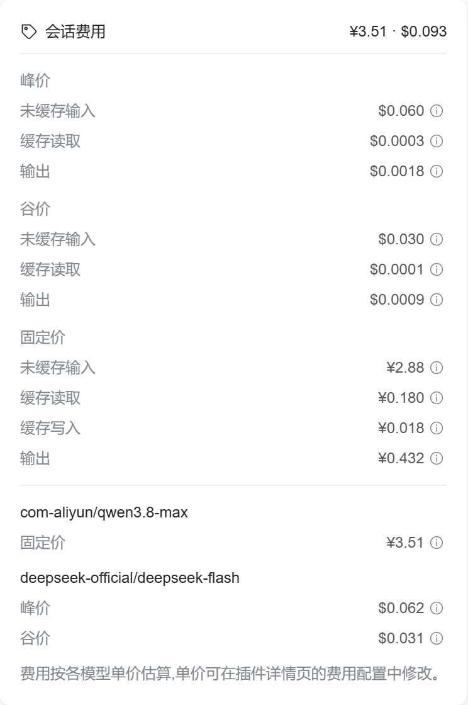
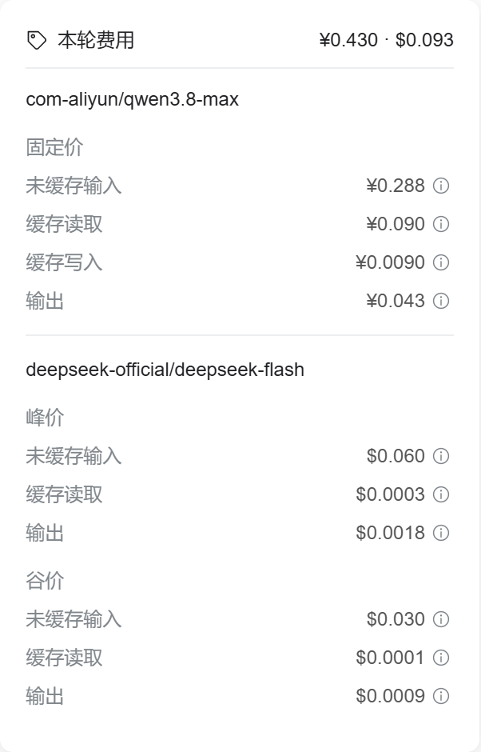

# @guojinpeng/dsh-cost-meter

[English](README.md) | [简体中文](README.zh-CN.md)

此插件用于估算 DSH 的会话费用和每轮费用。
需要 DSH 0.2.0-rc.2 或更高版本。
已在 DSH 0.2.0-rc.2 上测试。



## 安装

1. 安装 npm 包：

```powershell
dsh plugin --profile web add -w @guojinpeng/dsh-cost-meter
```

2. 重启 DSH。
3. 打开**插件**页面。
4. 选择 **@guojinpeng/dsh-cost-meter**，修改模型单价。

将 `web` 替换为你使用的 profile 名称。
如果已安装旧版无 scope 的插件，请先禁用旧版，再安装此插件。

通过 npm 安装已发布版本，npm 提供构建后的安装包。
GitHub 用于保存源码和发布说明。

## 功能

- 显示会话费用和已完成轮次的费用估算。会话费用胶囊位于输入区，本轮费用胶囊紧跟在官方“本轮用量”之后，时间保持在最后；两处都使用价格标签图标。
- 模型价格尚未就绪时显示简短的“初始化中”提示。
- 费用明细按峰价、谷价和固定价分组，每组列出未缓存输入、缓存读取、缓存写入和输出四项价格；金额为 0 的价格行不显示，不显示高峰和谷期 token。会话明细先按三组显示四项价格，再按模型显示各组汇总；本轮明细按模型列出各组的四项价格。
- 每个价格后有感叹号按钮：鼠标悬停只显示该价格的计算公式，移开即关闭。
- 按提供方分组显示模型。模型列表来自 DSH 调用历史和配置中已声明的模型。
- 按完整的 `provider/model` 名称分别设置单价。
- 可选择 models.dev、openrouter.ai 或 api.deepinfra.com 作为价格来源。
- 新模型从所选来源的本地缓存初始化价格；没有匹配价格时使用零价格。
- 只有手动点击“同步价格”才下载模型价格。价格来源、同步价格按钮和同步报告都显示在模型单价表格上方。
- 仅同步当前配置中的模型。同步结果先作为预览并入草稿，点击“保存”后写入配置。
- 按模型 ID 匹配第三方价格。models.dev 优先使用原厂按量价格；OpenRouter 和 DeepInfra 使用各自平台报价。匹配不明确时保留已有价格。
- 第三方数据无法提供受支持的单价时，保留已有价格。
- 每个模型独立选择 USD 或 CNY，切换币种时按汇率转换四项单价。
- 会话或轮次包含不同币种时，分别显示 USD 和 CNY 费用总额。
- 修改先保留在页面草稿中，点击页尾“保存”后写入配置文件。离开页面时丢弃未保存的修改。保存失败显示错误并保留草稿。
- 配置页分为“模型单价”和“通用”两个平铺分区，进入页面即显示全部内容。“通用”包含汇率、会话和轮次费用胶囊开关。
- 每个模型行的“更多单价”展开后显示缓存写入和“自动计算谷价”开关。打开开关后才显示该模型的“峰谷计费规则”，点击感叹号可查看所选规则的时段说明。
- 在“模型单价”标题右侧输入 `provider/model` 并点击“添加模型”，可为没有调用历史的模型声明单价。声明的模型随配置保存，未被历史发现的模型可以删除。
- 无效的单价或汇率在对应输入框显示红色边框和说明文字，并禁用“保存”和“同步价格”。
- 配置页复用 DSH 官方控件（保存表单、数值字段、开关、按钮、标记），尺寸、边框和配色与宿主设置页一致。
- 每个模型单独选择一套峰谷规则，谷价统一为高峰价的 50%：
- **DeepSeek 峰谷规则**（默认）：北京时间周一至周五 09:00–12:00、14:00–18:00 为高峰；周末、中国法定节假日及其余时段为谷时。
- **阿里云峰谷规则**：北京时间 22:00–次日 08:00 为错峰（谷时）；其余时段为忙时（高峰）。
- **智谱 GLM 峰谷规则**：北京时间周一至周五 14:00–18:00 为高峰；其余时段（含周末全天）为谷时。
- 使用 holiday-cn 年度日历，缓存到 `data/holidays/`，缺少年份时后台获取。
- 配置保存在 `~/.dsh/guojinpeng/dsh-cost-meter/config.json`。设置 `DSH_HOME` 后，使用该目录。
- 新配置不存在时，首次启动会复制旧的 `~/.dsh/dsh-cost-meter/config.json`。保留旧文件。
- 插件、客户端、接口、费用 projection、样式和配置使用独立命名空间。

以下截图使用示例模型价格，不代表实际账单。

旧模型没有币种字段时仍按 USD 读取。旧条目没有峰谷字段时保持固定价，主动打开开关后使用峰谷规则。新条目的“自动计算谷价”默认关闭。同步时，将已确认的 models.dev 原厂 DeepSeek 谷价乘以 2，保存为高峰基准价。每个模型按自己选择的规则计费，默认使用 DeepSeek 峰谷规则。

配置文件路径不变，无需迁移配置。历史用量通过日志回放恢复日期和北京时间七个时段（计费 projection 缓存版本 4）。跨时段请求按用量结算记录的时间估算。只有 DeepSeek 峰谷规则读取节假日日历，阿里云和 GLM 规则不读日历。节假日日历不可用时，无法确认的工作日窗口先按高峰价计算，日历到齐后更新估算。

`priceSource` 指定新模型使用的缓存来源。旧配置没有该字段时使用 models.dev。模型条目的 `source` 记录最近导入来源；在配置页手动修改单价后标记为 `manual`。仅切换来源不会修改已有单价或下载价格，费用计算仍只使用已保存的单价。

三个来源独立缓存到 `data/models.dev.json`、`data/openrouter.ai.json` 和 `data/api.deepinfra.com.json`。OpenRouter 和 DeepInfra 报价不乘以 2。已开启自动谷价的 DeepSeek 条目，在来源无法确认官方高峰基准价时保留原价。同步结果显示跳过的模型，以及因缓存时长无法确定而保留的缓存写入价格。条件价格和非 token 收费不属于当前固定单价估算范围。

会话费用明细：



本轮费用明细：



模型单价配置：


## 从源码开发

安装 Node.js、pnpm 9 和 Git。运行测试前，先全局安装 DSH：

```powershell
npm install -g @deepseek-ai/dsh@0.2.0-rc.2
git clone https://github.com/guojinpeng/dsh-cost-meter.git
cd dsh-cost-meter
pnpm install --frozen-lockfile
```

修改 `src/` 中的代码。运行测试并生成安装包：

```powershell
npm test
npm run build
npm pack
```

`npm pack` 也会执行构建，生成 `guojinpeng-dsh-cost-meter-<版本号>.tgz`。
将生成的文件安装到你的 DSH profile。以 0.3.2 为例：

```powershell
dsh plugin --profile web add -w ./guojinpeng-dsh-cost-meter-0.3.2.tgz
```

重启 DSH，检查插件。每次修改后，重新构建、打包并安装。
测试使用全局安装的 DSH。如果安装位置不同，将 `DSH_RUNTIME_ROOT` 设置为 DSH 包目录。
提交源码和 `pnpm-lock.yaml`。不要提交生成文件或本地配置。
模块职责、依赖边界和验证命令见[模块维护说明](docs/architecture.md)。

## 发布到 npm

使用有权发布 `@guojinpeng/dsh-cost-meter` 的 npm 账号。
在项目目录执行：

```powershell
npm login --registry=https://registry.npmjs.org/
npm whoami --registry=https://registry.npmjs.org/
npm view @guojinpeng/dsh-cost-meter version --registry=https://registry.npmjs.org/
```

包尚未发布时，`npm view` 可能返回 `E404`。
更新已发布的包时，新版本必须高于已发布版本。
修改 `package.json`。也可以用以下命令递增补丁版本，不自动创建 Git 标签：

```powershell
npm version patch --no-git-tag-version
pnpm install --lockfile-only
npm test
npm run pack:release
```

检查安装包的文件列表。`pack:release` 执行 `npm pack`，生成带版本号的 npm 安装包。
提交并推送版本变更，然后发布该安装包。
执行前，将 `<version>` 替换为本次的新版本号：

```powershell
npm publish ./guojinpeng-dsh-cost-meter-<version>.tgz --access public --registry=https://registry.npmjs.org/
npm view @guojinpeng/dsh-cost-meter version --registry=https://registry.npmjs.org/
```

根据提示完成 npm 身份验证。
同一包版本只能发布一次。
npm 发布成功后，创建对应的 Git 标签和 GitHub Release：

```powershell
git tag v<version>
git push origin v<version>
gh release create v<version> --verify-tag --title "<version>" --generate-notes --latest
```

执行前替换 `<version>`。GitHub Release 用于发布说明，无需上传安装包。
npm 托管安装包，插件市场通过 npm 包的 `repository` 字段关联仓库。

发布后，用户可执行以下命令安装：

```powershell
dsh plugin --profile web add -w @guojinpeng/dsh-cost-meter
```
