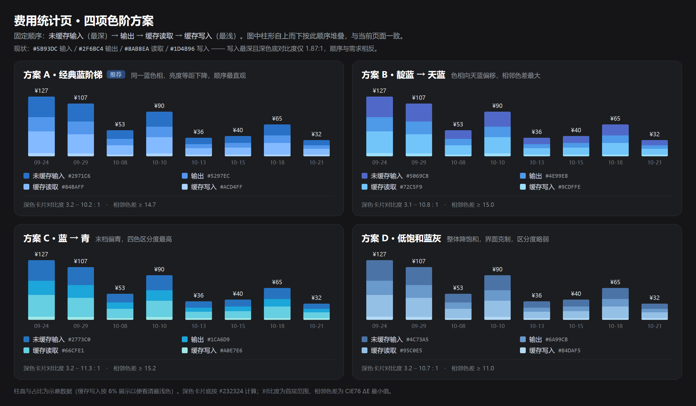

# 费用统计页优化方案：日均费用口径与四项色阶

日期：2026-10-22　目标版本：0.4.6　状态：已实现并打包（0.4.6）

## 0. 结论

1. 日均费用：五个时间范围和自定义范围统一按“有费用天数”计算。服务端新增 `billedDays` 字段，客户端用“总费用 ÷ billedDays”。无计费天数时显示 “—”。
2. 四项颜色：只替换 4 个 CSS 变量，顺序改为 未缓存输入（最深）→ 输出 → 缓存读取 → 缓存写入（最浅）。给出 A 到 D 共 4 套候选，推荐方案 A。
3. 工作量约 1.5 人日。不改变接口结构，不改变图表结构。

## 1. 问题复核

### 1.1 日均费用

当前实现分两处：

- `src/server/overview.js:153`

```js
days: (range === 'custom' ? dayCount(start, end) : rangeDays(range)) ?? Math.max(dates.size, 1),
```

- `src/client/cost-overview.js:285`

```js
const average = view.totalMicros / Math.max(data.days, 1);
```

问题：

- today、7 天、30 天、90 天用固定窗口天数做分母：1、7、30、90。
- “全部”用历史中出现过用量的天数。
- 自定义范围用日历天数。
- 范围内只要有空白天，日均就被拉低。范围越长，偏差越大。
- 同一个用户在 30 天范围有 14 天产生费用时，当前显示“总费用 ÷ 30”，不是“总费用 ÷ 14”。

### 1.2 四项颜色

- `src/client/cost-overview.js:8-13` 的注释写 “Token series, darkest first”，顺序为 input、output、read、write。
- `src/client/styles.css:505-510` 的注释和取值却写 “lightest step is cache read, the darkest is cache write”。
- 实际映射：read `#8ab8ea` 最浅，write `#1d4b96` 最深。与需求顺序相反。
- 深色卡片底 `#232324` 上，write `#1d4b96` 的对比度只有 1.87:1，几乎融于背景。
- 趋势柱的视觉堆叠（自上而下）为 input、output、read、write。来源是 `cost-overview.js:381` 的 `.reverse()` 加 `.gdcc_ovBar` 的 `flex-direction: column-reverse`。

## 2. 日均费用改造方案

### 2.1 口径定义

**有费用天数（billedDays）**：所选范围内，当日费用合计大于 0 的天数。

日均费用 = 总费用 ÷ 有费用天数。

| 范围 | 分母 |
| --- | --- |
| 今天 | 今天有费用记 1，否则 0 |
| 7 天 | 7 天内有费用的天数（0 到 7） |
| 30 天 | 30 天内有费用的天数（0 到 30） |
| 90 天 | 90 天内有费用的天数（0 到 90） |
| 全部 | 历史中有费用的天数 |
| 自定义 | 起止日期内有费用的天数 |

补充规则：

- 有 token 但单价为 0（未定价模型）的日期，费用为 0，不计入分母。
- 时间为 unknown 的用量计入总费用，但不属于任何一天。沿用现状，不做特殊处理。
- 分母为 0 时不显示 ¥0.00，显示 “—”，避免误解。

### 2.2 服务端改动

文件：`src/server/overview.js`

把第 142 到 143 行和第 153 行改为：

```js
const daily = buildTrend(accounting, config, 'day');
const billedDays = daily.filter((unit) => unit.totalMicros > 0).length;
const granularity = range === 'all' && dates.size > MONTH_THRESHOLD_DAYS ? 'month' : 'day';
const trend = mergeTrend(granularity === 'day' ? daily : buildTrend(accounting, config, 'month'));
```

返回字段把 `days` 改为 `billedDays`：

```js
billedDays,
```

说明：

- 日粒度直接复用 `daily`，只多一次按月聚合（仅“全部”且超过 60 天时发生）。
- `rangeDays`、`dayCount` 不再用于日均。确认没有其他调用后删除这两个导出，减少死代码。
- `RANGE_DAYS` 继续用于请求参数校验。

### 2.3 客户端改动

文件：`src/client/cost-overview.js`

```js
const billedDays = data.billedDays ?? data.days;          // 兼容升级前的 15 分钟缓存
const average = billedDays > 0 ? view.totalMicros / billedDays : null;
```

KPI 提示改为：

```js
average === null
  ? t('kpiNoBilledDay')
  : t('kpiAvgPerDay', { amount: money(average), days: billedDays }),
```

文件：`src/client/locales.js`

```js
kpiAvgPerDay: `日均 {amount} · {days} 天有费用`,
kpiNoBilledDay: `范围内没有计费`,
```

```js
kpiAvgPerDay: `{amount} per day · {days} billed days`,
kpiNoBilledDay: `No billed day in range`,
```

这样用户能直接看到分母，不会再把“日均”误解为日历日均摊。

### 2.4 测试改动

文件：`tests/overview-data.test.js`

| 位置 | 当前断言 | 新断言 |
| --- | --- | --- |
| 第 225 行 | `day.days === 7` | `day.billedDays === 1`（7 天范围只有 10-19 有费用） |
| 第 242 行 | `all.days === 2` | `all.billedDays === 2` |
| 第 279 行 | `payload.days === 30` | `payload.billedDays === 0` |
| 第 308 行 | `payload.days === 9` | `payload.billedDays === 1`（只有 10-10 有费用） |

新增用例：

1. 30 天范围内 14 天有费用，`billedDays === 14`。
2. 同一天多个 route 的用量合并后只算 1 天。
3. 日期有 token 但未定价、费用为 0 时，不计入 `billedDays`。
4. “今天”有费用时 `billedDays === 1`，无费用时 `billedDays === 0`。

文件：`tests/overview-handler.test.js`

第 78 行：`custom.body.days === 3` 改为 `custom.body.billedDays === 0`（该用例没有会话数据）。

### 2.5 兼容与边界

- 旧缓存：升级后首次请求可能命中旧 payload，没有 `billedDays`。客户端用 `?? data.days` 回退，最多 15 分钟后恢复。
- 时区：日界沿用北京时间，与趋势图一致。
- 性能：`buildTrend` 按已聚合的时间桶计算，每日一次定价，开销可以忽略。

## 3. 配色方案



### 3.1 设计约束

- 亮度单调：未缓存输入 > 输出 > 缓存读取 > 缓存写入（由深到浅）。
- 相邻色差要够大，小色块（图例 8px、圆环细段）也能区分。
- 深色卡片底 `#232324` 上，最深色对比度不低于 3:1。
- 保持蓝色系，不引入会被误读为其他指标的颜色。
- 只改 4 个变量，图例、趋势柱、圆环、时段分布自动继承。

### 3.2 候选方案

顺序：未缓存输入 / 输出 / 缓存读取 / 缓存写入。

| 方案 | 未缓存输入 | 输出 | 缓存读取 | 缓存写入 | 深底对比度 | 相邻 ΔE 最小值 |
| --- | --- | --- | --- | --- | --- | --- |
| A 经典蓝阶梯（推荐） | `#2971C6` | `#5297EC` | `#84BAFF` | `#ACD4FF` | 3.2 – 10.2 : 1 | 14.7 |
| B 靛蓝 → 天蓝 | `#5069C8` | `#4E99E8` | `#72C5F9` | `#9CDFFE` | 3.1 – 10.8 : 1 | 15.0 |
| C 蓝 → 青 | `#2773C0` | `#1CA6D9` | `#66CFE1` | `#A0E7E6` | 3.2 – 11.3 : 1 | 15.2 |
| D 低饱和蓝灰 | `#4C73A5` | `#6A99CB` | `#95C0E5` | `#B4DAF5` | 3.2 – 10.7 : 1 | 11.0 |

对比口径：深色卡片底 `#232324`。ΔE 为 CIE76，取相邻两色的最小值。

### 3.3 推荐

推荐方案 A。

- 单一蓝色相，只靠亮度分层，最符合作者的“由深变浅”直觉。
- 最深色和次深色的对比度都达到 3:1，深色主题下四项都清晰。
- 相邻 ΔE 都大于 14，区分度稳定。
- 色相不变，最不容易被误读为不同的计费类型。

方案 B 的层次更丰富，适合想要一点冷色渐变的设计。方案 C 区分度最高，但青绿色会削弱“费用”语义。方案 D 最克制，但小色块下区分偏弱。

### 3.4 实施

文件：`src/client/styles.css:505-510`

```css
/* Four-step blue ramp, darkest to lightest:
   uncached input, output, cache read, cache write. */
--gdcc-ov-input: #2971c6;
--gdcc-ov-output: #5297ec;
--gdcc-ov-read: #84baff;
--gdcc-ov-write: #acd4ff;
```

同时同步第 505 到 506 行的注释，避免注释和取值再次矛盾。

可选：当前堆叠顺序是 input 在最上。如果希望深色在柱底，删除 `cost-overview.js:381` 的 `.reverse()`。本方案默认不改，减少视觉变动。

## 4. 验收清单

- 30 天范围只有 14 天有费用时，日均 = 总费用 ÷ 14，提示显示 “14 天有费用”。
- 7 天、90 天、全部、自定义范围与 30 天口径一致。
- 无费用范围显示 “—”，不显示 ¥0.00。
- 趋势柱、图例、圆环、时段分布四处颜色一致。
- 四色亮度严格递减，深色卡片上最深色对比度不低于 3:1。
- `npm test` 通过。

## 5. 排期

| 步骤 | 内容 | 工作量 |
| --- | --- | --- |
| 1 | 服务端 billedDays 与单测 | 0.5 天 |
| 2 | 客户端 KPI 与中英文案 | 0.5 天 |
| 3 | 配色替换与双主题检查 | 0.2 天 |
| 4 | 文档、CHANGELOG、版本号 | 0.2 天 |

合计约 1.5 人日。

## 6. 已确认

1. 配色采用方案 A。
2. 分母按“费用大于 0”的日期计算。
3. 柱形堆叠顺序不变：深色在顶部，表示花钱多的未缓存输入；浅色在底部，表示缓存命中。
